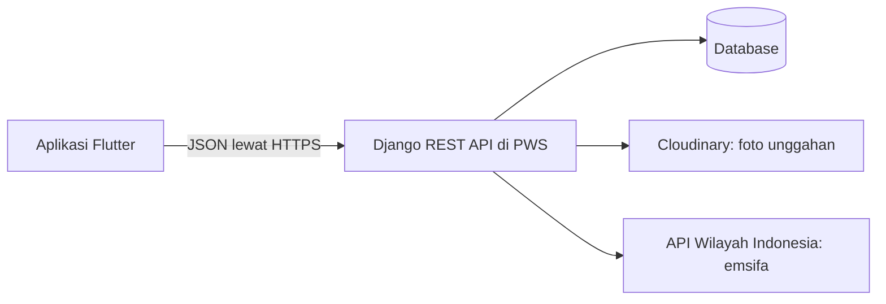
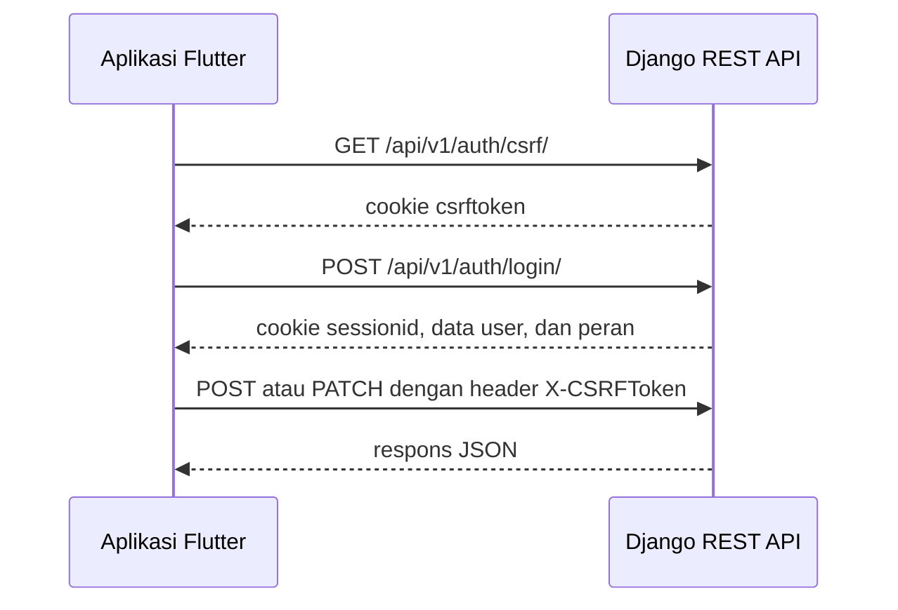

<div align="center">

# ReBatik Mobile

Klien mobile Flutter untuk ReBatik: platform upcycling yang mengubah pakaian dan kain tak terpakai
menjadi karya baru bernuansa batik Nusantara.


[Tentang](#tentang) · [Modul](#modul) · [Alur Pengguna](#alur-pengguna) · [Arsitektur](#arsitektur) · [API](#referensi-api) · [Menjalankan](#menjalankan) · [Tim](#tim) · [Troubleshooting](#troubleshooting--masalah-umum)

</div>

---

## Tentang

Lemari penuh pakaian yang tidak lagi dipakai, kain sisa jahitan, atau batik lama yang
tersimpan bertahun-tahun: semuanya bisa punya hidup kedua. Setiap tahun, banyak pakaian dan
kain berakhir di tempat pembuangan padahal masih bisa diolah. ReBatik mempertemukan tiga pihak
dalam satu aplikasi: **orang yang punya kain bekas**, **pengrajin yang bisa mengolahnya**, dan
**pembeli yang mencari produk berkelanjutan dengan sentuhan batik**. Di sini kamu bisa menemukan
tempat menyalurkan kain bekas, mengajukan pengolahannya menjadi produk baru, memesan desain batik
sesuai gayamu, dan mengumpulkan poin dari setiap kontribusi.
 
Ini adalah aplikasi mobile ReBatik yang dibangun dengan Flutter untuk mata kuliah Pemrograman
Berbasis Platform (PBP) Gasal 2026/2027, **Kelompok 1 PBP-D**. Aplikasi ini adalah pendamping dari
[ReBatik web](https://alisa-selvia-rebatik.pws.cs.ui.ac.id/): data, akun, dan aturan bisnisnya
sama karena terhubung ke backend yang sama melalui Django REST Framework.

| | |
|---|---|
| **Mata kuliah** | Pemrograman Berbasis Platform (CSGE602022), Gasal 2026/2027 |
| **Kelompok** | Kelompok 1, kelas PBP-D |
| **Platform** | Flutter (Dart 3), Material 3 |
| **Backend** | Django 5.2 dan Django REST Framework, di-deploy di PWS Fasilkom UI |
| **Tema** | Upcycling limbah tekstil dan pelestarian budaya batik |

## Kenapa kain bekas jarang dimanfaatkan

Niat untuk mengurangi limbah sudah ada, tetapi lima hal ini sering menghentikannya. Tiap hal
punya modul yang menjawabnya.

| Yang terpikir | Yang ReBatik lakukan |
|---------------|----------------------|
| "Limbah tekstil itu sebenarnya sebanyak apa, dan kontribusiku berarti nggak?" | Landing Page & Impact Tracker menampilkan permasalahan limbah tekstil dan statistik kain yang berhasil dialihkan dari limbah. |
| "Batik yang aku pakai ini maknanya apa, dan bagaimana kalau aku mau desain sendiri?" | Batik Story menjelaskan sejarah, asal, dan filosofi motif. Batik Custom memberi rekomendasi desain dari gender, style, dan color palette. |
| "Mau beli produk ramah lingkungan, tapi di mana? Dan kain bekasku mau dibawa ke mana?" | Marketplace menjual produk hasil upcycling, dan Drop-Off Point menunjukkan lokasi pengumpulan kain terdekat. |
| "Bajuku masih bagus, sayang kalau dibuang." | Donasi Kain/Pakaian mengumpulkan foto, kategori, kondisi, dan deskripsi barang. Profil mencatat riwayat dan kontribusimu. |
| "Aku punya kain favorit, bisa dijadikan tas atau pouch?" | Upcycling Request menerima pengajuan, memantau statusnya, dan memberi poin lewat Points/Reward yang bisa ditukar voucher diskon. |

**Untuk siapa:** mahasiswa dan pekerja yang punya pakaian tidak terpakai, pencinta batik yang
ingin desain sendiri, pembeli produk ramah lingkungan, dan siapa pun yang ingin mengurangi
limbah tekstil.

## Tim

**Kelompok 1 · PBP-D**

| Nama | NPM | Tanggung jawab |
|------|-----|----------------|
| Ausy Dhafa Adhitama | 2406417954 | Modul 1: Landing Page & Impact Tracker |
| Alisa Selvia Saharani | 2506618433 | Modul 2: Batik Custom & Batik Story, autentikasi, navbar, notifikasi, pengaturan |
| Ahyan Timuardi | 2506547203 | Modul 3: Marketplace & Drop-Off Point |
| Rani Faizah A | 2506624013 | Modul 4: Donasi Kain/Pakaian & Profile |
| M. Rezky Syahputra | 2506614006 | Modul 5: Upcycling Request & Points/Reward |

## Modul

Alur ReBatik: **Donasi** kain atau pakaian, **Ajukan** upcycling, **Rancang** batik custom,
**Belanja** produk di marketplace, lalu **Kumpulkan** poin untuk ditukar voucher. Poin yang
didapat dari donasi dan upcycling kembali dipakai untuk belanja produk hasil upcycling.

| Modul | Nama Modul | Fungsinya | Penanggung Jawab |
|:-----:|-----------|-----------|------------------|
| 1 | Landing Page & Impact Tracker | Memperkenalkan konsep, tujuan, dan manfaat ReBatik, menjelaskan permasalahan limbah tekstil, serta menyajikan statistik kontribusi (jumlah barang donasi, upcycling, dan donatur) | Ausy Dhafa Adhitama |
| 2 | Batik Custom & Batik Story | Batik Story: sejarah, asal-usul, filosofi, dan makna motif. Batik Custom: desain berdasarkan gender, style, dan color palette, rekomendasi sesuai tone warna, diterapkan ke model pakaian, lalu dipesan | Alisa Selvia Saharani |
| 3 | Marketplace & Drop-Off Point | Menjelajahi dan membeli produk hasil upcycling, serta menemukan 52 lokasi pengumpulan kain/pakaian bekas | Ahyan Timuardi |
| 4 | Donasi Kain/Pakaian & Profile | Mengunggah donasi (foto, kategori, kondisi, deskripsi), menampilkan akun, riwayat donasi, riwayat pesanan, dan kontribusi | Rani Faizah A |
| 5 | Upcycling Request & Points/Reward | Mengajukan pengolahan kain menjadi produk baru, memantau status, mengumpulkan poin, dan menukarnya dengan voucher diskon Marketplace | M. Rezky Syahputra |

**Di luar modul (dikerjakan Alisa Selvia Saharani):** autentikasi Sign In & Sign Up,
navbar/drawer, notifikasi aktivitas pengguna, dan halaman pengaturan akun.

> **Satu akun, satu kali isi.** Aplikasi memakai akun, peran, dan notifikasi yang sama dengan
> web. Di mobile, data akun hanya dibaca dari API, sehingga tidak perlu diisi dua kali.


## Alur pengguna

Tiga contoh perjalanan di dalam aplikasi (ilustrasi).

**Donatur: dari lemari ke tangan pengrajin**

1. Membuka *Drop-Off Point* dan mencari titik pengumpulan terdekat berdasarkan kota.
2. Mengisi form *Donasi* dengan foto, jenis, kondisi, dan jumlah barang.
3. Memantau status donasi dari *Profil*, lalu menerima poin setelah donasi selesai.
4. Menukar poin di *Points & Reward* menjadi voucher diskon.

**Pecinta batik: dari inspirasi ke pesanan**

1. Membaca *Batik Story* untuk mengenal makna motif yang disukai.
2. Menyusun desain di *Batik Custom*: memilih gender, style, dan color palette.
3. Menerima rekomendasi motif, menyimpan desain, lalu memesannya.

**Pemilik kain favorit: dari kain jadi produk**

1. Mengajukan *Upcycling Request* dengan memilih jenis kain dan produk yang diinginkan.
2. Mengikuti status pengajuan, mulai dari peninjauan, persetujuan harga, produksi, sampai selesai.
3. Mengonfirmasi penerimaan produk dan mengumpulkan poin.

## Peran pengguna

ReBatik mengenal empat peran: Guest, Eco-Member, Artisan, dan Admin. Aplikasi mobile berfokus pada
**Guest** dan **Eco-Member**. Pengelolaan Artisan dan Admin tetap dilakukan di web karena
menyangkut operasional platform.

| Aksi | Guest | Eco-Member |
|------|:-----:|:----------:|
| Membaca Landing Page, Impact Tracker, dan Batik Story | ✓ | ✓ |
| Melihat Drop-Off Point dan menjelajahi Marketplace | ✓ | ✓ |
| Merancang Batik Custom | ✓ | ✓ |
| Menyimpan desain dan memesan Batik Custom | | ✓ |
| Membeli produk dan melacak pesanan | | ✓ |
| Mendonasikan kain atau pakaian | | ✓ |
| Mengajukan dan memantau upcycling | | ✓ |
| Mengumpulkan dan menukar poin | | ✓ |
| Mengelola profil, notifikasi, dan pengaturan | | ✓ |

Pengguna hanya dapat melihat dan mengubah data miliknya sendiri.

## Arsitektur

Aplikasi tidak menyimpan data sendiri. Seluruh data dibaca dan ditulis lewat REST API, dan aturan
bisnis tetap berada di server.



Autentikasi memakai **session Django dengan perlindungan CSRF**, sama seperti web:



Data wilayah untuk form alamat diambil dari API Wilayah Indonesia (emsifa) melalui backend, yang
menyimpan cache agar aplikasi tidak bergantung langsung pada layanan eksternal.

## Referensi API

Base URL: `https://alisa-selvia-rebatik.pws.cs.ui.ac.id`

Endpoint bertanda *(rencana)* sedang disiapkan di backend.

| Modul | Method | Endpoint | Fungsi |
|:-----:|:------:|----------|--------|
| Auth | GET | `/api/v1/auth/csrf/` | Mengambil token CSRF |
| Auth | POST | `/api/v1/auth/login/` · `/register/` · `/logout/` | Masuk, daftar, keluar |
| Auth | GET | `/api/v1/auth/me/` | Data pengguna dan peran |
| Auth | GET · POST | `/api/v1/auth/notifications/` · `.../read-all/` · `.../<id>/read/` | Notifikasi |
| 1 | GET | `/api/v1/impact-tracker/` *(rencana)* | Statistik Impact Tracker |
| 2 | GET | `/api/v1/batik-story/motifs/` · `/motifs/<uuid>/` · `/origins/` | Katalog motif dan asal daerah |
| 2 | POST | `/api/v1/batik-story/motifs/<uuid>/favorite/` | Memfavoritkan motif |
| 2 | GET | `/api/v1/batik-custom/styles/` · `/palettes/` · `/motifs/` · `/product-options/` | Katalog Batik Custom |
| 2 | GET · POST | `/api/v1/batik-custom/designs/` · `/designs/<id>/` | Desain tersimpan |
| 2 | GET · POST | `/api/v1/batik-custom/orders/` · `/orders/<id>/` | Pesanan custom |
| 2 | GET · PUT | `/api/v1/profile/settings/` *(rencana)* | Pengaturan akun |
| 3 | GET | `/marketplace/api/dropoff-points/` · `.../<code>/` | 52 titik Drop-Off Point, filter `?city=` dan `?q=` |
| 3 | GET | `/marketplace/api/regions/` | Provinsi dan kabupaten |
| 3 | GET · POST | `/api/v1/marketplace/products/` · `/orders/` *(rencana)* | Produk dan pesanan |
| 4 | GET · POST | `/api/v1/donasi/` *(rencana)* | Ajukan dan riwayat donasi |
| 4 | GET · PUT | `/api/v1/profile/` *(rencana)* | Profil pengguna |
| 5 | GET · POST | `/api/v1/upcycling/requests/` · `/requests/<uuid>/` | Daftar, ajukan, dan detail pengajuan |
| 5 | POST | `/api/v1/upcycling/requests/<uuid>/` + `fabric-handoff` · `approve-quote` · `product-delivery` · `confirm-completion` · `cancel` | Aksi pada tiap tahap pengajuan |
| 5 | GET · POST | `/api/v1/rewards/points/` · `/catalog/` *(rencana)* | Saldo poin dan penukaran voucher |

Respons galat mengikuti pola DRF: `400` untuk validasi, `401` atau `403` bila belum masuk atau
tidak berhak, dan `404` bila data tidak ditemukan.

## Menjalankan

```bash
git clone <url-repository> rebatik-mobile
cd rebatik-mobile

flutter pub get
flutter run                # perangkat atau emulator yang aktif
flutter run -d chrome      # cara cepat melihat tampilan
```

Aplikasi membutuhkan backend yang hidup. Untuk pengembangan lokal arahkan alamat backend ke
`http://127.0.0.1:8000` (Chrome) atau `http://10.0.2.2:8000` (emulator Android). Untuk demo di
perangkat fisik, gunakan alamat PWS di atas.

| Perintah | Kegunaan |
|----------|----------|
| `flutter analyze` | Memeriksa kualitas kode |
| `flutter test` | Menjalankan widget test |
| `flutter build apk --release` | Membangun APK rilis |

## Troubleshooting & Masalah Umum

| Gejala / Pesan Error | Kemungkinan Penyebab | Solusi |
|---|---|---|
| `flutter: command not found` | Jalur folder `flutter/bin` belum terdaftar pada variabel `PATH`. | Masukkan jalur lengkap folder `flutter/bin` ke System/User Environment Variables `PATH`, simpan, lalu buka sesi terminal baru. |
| `Some Android licenses not accepted` | Lisensi komponen SDK Android belum disetujui. | Jalankan `flutter doctor --android-licenses` di terminal dan ketik `y` pada setiap pertanyaan. |
| `Visual Studio not installed` | Deteksi toolchain Windows C++. | Boleh diabaikan dengan aman jika target eksekusi adalah Android atau Web (Google Chrome). |
| `Error: The method '...' isn't defined for the class 'MyHomePage'` | Ada kurung kurawal `{}` yang salah tutup atau penempatan method di luar kelas. | Periksa kembali struktur kurung kurawal pada berkas `menu.dart`. Pastikan method `build` berada di dalam cakupan blok `class MyHomePage`. |
| `Undefined name 'MyHomePage'` di `main.dart` | Berkas `menu.dart` belum diimpor ke `main.dart`. | Tambahkan baris `import 'package:myportofolio_mobile/menu.dart';` di bagian paling atas `main.dart`. |
| Proses `flutter run` terhenti lama pada *Running Gradle task ‘assembleDebug’…* | Pertama kali mengunduh file wrapper Gradle dan dependensi Android. | Hal ini wajar pada kompilasi pertama karena Gradle mengunduh file inti. Pastikan koneksi internet stabil dan biarkan proses berjalan beberapa menit. Opsi alternatif yang lebih cepat adalah menjalankan aplikasi pada Google Chrome dengan `flutter run -d chrome`. |

## Tautan

| | |
|---|---|
| **Desain UI/UX** | [Figma ReBatik](https://www.figma.com/team_invite/redeem/xncR93E4zlnRJtCDqu4D7p?t=LXe1ZVPkQu6McFi1-21) |
| **Website dan sumber data** | [alisa-selvia-rebatik.pws.cs.ui.ac.id](https://alisa-selvia-rebatik.pws.cs.ui.ac.id/) |
| **APK** | Menyusul menjelang pengumpulan akhir |


